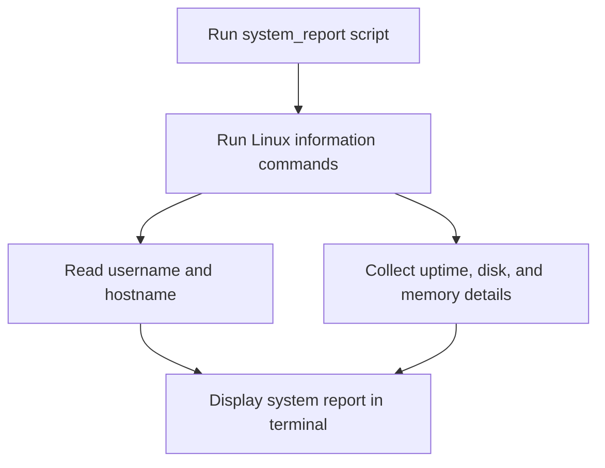
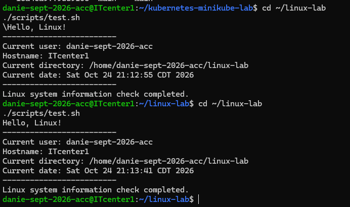

# Linux and Bash Scripting Lab

## Project Overview

This project documents foundational Linux command-line learning
and a simple Bash script that displays system information.

It is part of my hands-on portfolio for Linux administration
and AWS Cloud System Administrator roles.

## Technology

- Ubuntu Linux
- Bash shell scripting
- Linux command-line utilities
- Git and GitHub

## Project Files

- `notes.txt` — introductory Linux learning notes
- `scripts/test.sh` — Bash script that displays basic system information
- `.gitignore` — excludes local files and sensitive data

## Run the Script

From the project directory, make the script executable:

    chmod +x scripts/test.sh

Run it:

    ./scripts/test.sh

The script displays the current user, hostname, working directory,
and date. It does not modify system configuration or delete files.

## Skills Practiced

- Navigating a Linux directory
- Creating and editing files
- Using Bash scripts
- Working with executable permissions
- Running Linux commands from a script
- Tracking project changes with Git

## Future Improvements

- Check disk space and memory usage
- Add file and directory checks
- Add command-line arguments
- Add automated tests for script behavior

## Workflow Diagram

This diagram shows how the Bash system-report script gathers and displays Linux information.

## Screenshot Evidence

This screenshot shows an example run of the system-report script on Ubuntu.
